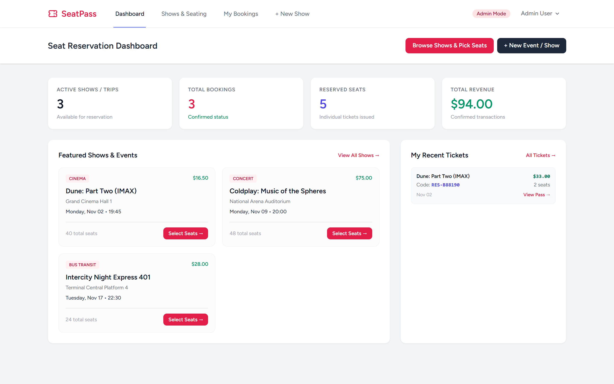
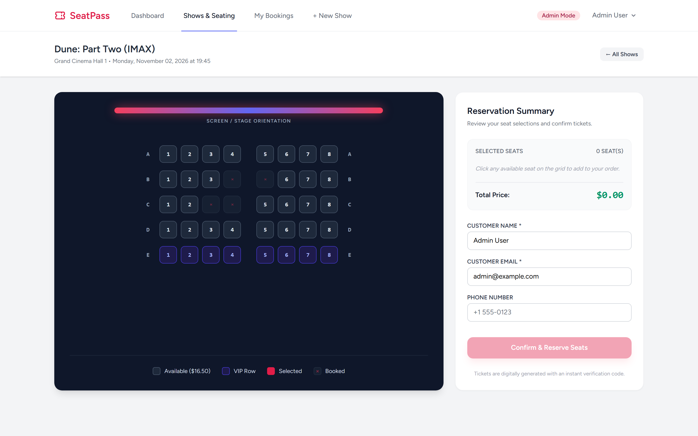
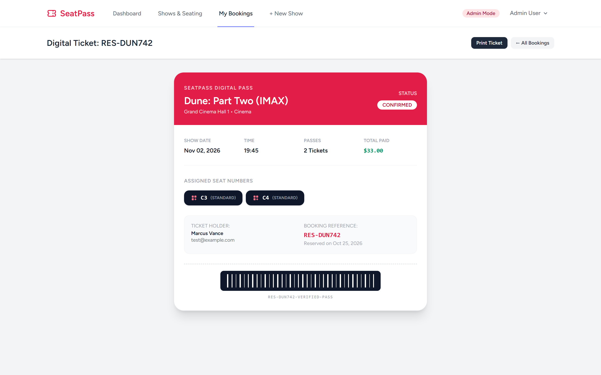
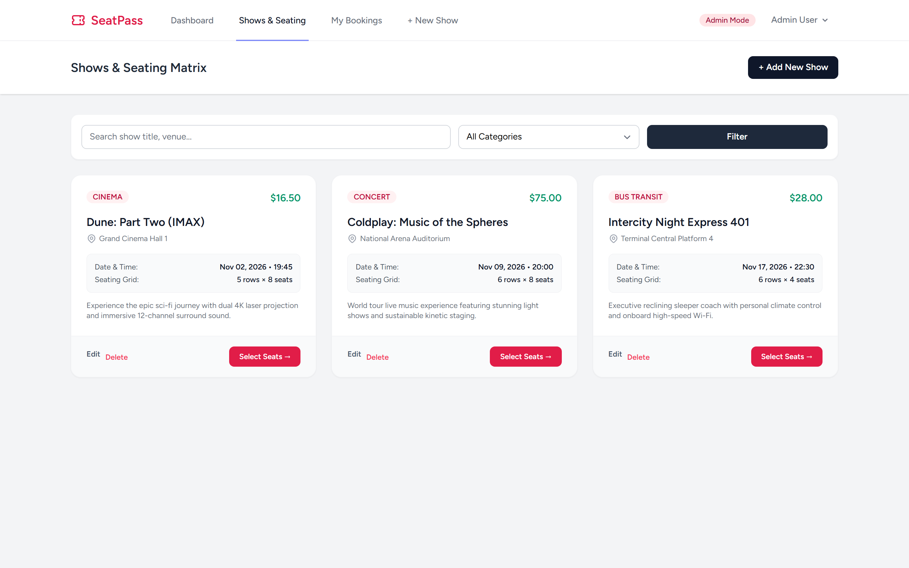

# SeatPass - Interactive Seat Reservation System

Repository: https://github.com/0xyz-exe/seat-reservation-app-laravel

An interactive real-time seat reservation, cinema theater, and transit booking platform built with Laravel 13, Blade, Tailwind CSS, Alpine.js, and SQLite.

## Features

- ✅ **Interactive Visual Grid**: Real-time 2D seating matrix with stage/screen orientation, center aisles, and row letters.
- ✅ **Color-Coded Statuses**: Clear visual distinctions for Available, Selected, VIP tier, and Booked/Disabled seats.
- ✅ **Dynamic Pricing**: Support for standard and VIP seating tiers with automatic live subtotal recalculations.
- ✅ **Duplicate Booking Safeguards**: Double-reservation prevention ensuring simultaneous buyers cannot take the same seat.
- ✅ **Digital Boarding Pass**: Printable receipt and ticket pass with unique booking reference codes and barcodes.
- ✅ **Cancellation & Seat Release**: Allows customers to cancel future bookings and instantly restore seat availability.
- ✅ **Admin Show Creator**: Administrators can create new shows and automatically generate custom row-and-column seating matrices.

## Screenshots

| Tampilan | Preview |
|---|---|
| **Dashboard Pemesanan Kursi**<br>Ringkasan statistik pertunjukan aktif, total tiket terkonfirmasi, kursi terisi, dan katalog tayang terdekat |  |
| **Matriks Kursi 2D Interaktif**<br>Pemilihan kursi visual real-time dengan orientasi panggung/layar, pembeda lorong tengah, status VIP, dan kalkulasi subtotal instan |  |
| **Tiket & Boarding Pass Digital**<br>Tampilan tiket resmi dengan kode referensi unik, simulasi barcode, rincian kursi, data pelanggan, dan fungsi cetak |  |
| **Manajemen Pertunjukan & Acara**<br>Katalog lengkap pertunjukan dengan filter kategori, jadwal tanggal, konfigurasi dimensi kursi, dan aksi edit/kelola |  |

---

## Tech Stack

Laravel 13.38.0 · Breeze 2.4 · SQLite · Tailwind CSS · Alpine.js

## Installation

```bash
git clone https://github.com/0xyz-exe/seat-reservation-app-laravel.git
cd seat-reservation-app-laravel
composer install && npm install && npm run build
cp .env.example .env && php artisan key:generate
touch database/database.sqlite
php artisan migrate --seed
php artisan serve
```

### Demo Accounts

All accounts use the password: `password`

- **Admin**: `admin@example.com` (Create shows, customize seating configurations, moderate all bookings)
- **Customer**: `test@example.com` (Marcus Vance - browse shows, select seats visually, view digital passes)

## Database Schema

- **users**: `id`, `name`, `email`, `password`, `is_admin`, `timestamps`
- **events**: `id`, `title`, `category` (Cinema/Concert/Theater/Bus Transit), `venue`, `show_date`, `start_time`, `ticket_price`, `total_rows`, `seats_per_row`, `description`, `status`, `timestamps`
- **seats**: `id`, `event_id`, `seat_number`, `row_letter`, `column_number`, `seat_type` (standard/vip), `price`, `timestamps`
- **bookings**: `id`, `booking_code`, `user_id`, `event_id`, `total_seats`, `total_price`, `status` (confirmed/cancelled), `customer_name`, `customer_email`, `customer_phone`, `timestamps`
- **booking_seats**: `id`, `booking_id`, `seat_id`, `price`, `timestamps`

## License

MIT
